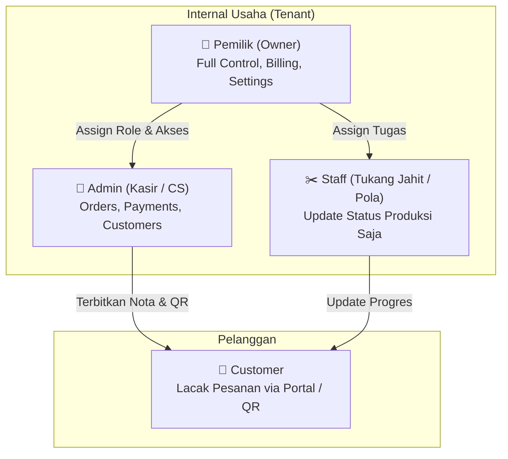
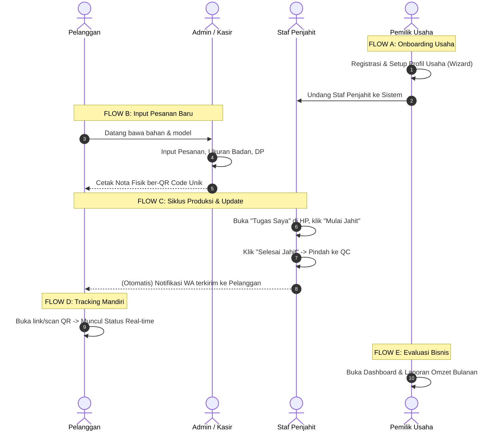

# 01. Analisis Product Requirements Document (PRD) & Kebutuhan Sistem

Dokumen ini menyajikan telaah mendalam terhadap **PRD TailorHub (v1.0 Draft Awal)** untuk memahami visi produk, dinamika pasar sasaran, batasan fungsionalitas, serta arsitektur peran pengguna.

---

## 1. Identitas Produk & Problem-Solution Fit

### 1.1 Masalah Riil Industri Jahit & Konveksi (The Problem)
Industri jahit dan konveksi di Indonesia—mulai dari skala penjahit rumahan, butik kustom kebaya/jas, hingga konveksi seragam skala menengah—memiliki karakteristik operasional yang sangat unik namun rentan inefisiensi:
1. **Pencatatan Manual Rentan Rusak/Hilang**: Nota kertas atau buku besar fisik sering tercecer, tersiram air, atau sobek di lantai produksi yang berdebu benang dan kain.
2. **Ketiadaan Visibilitas Progres Produksi**: Pemilik usaha kesulitan mengetahui pesanan mana yang sedang dipotong, dijahit, atau difinishing tanpa harus bertanya satu per satu ke staf penjahit.
3. **Komplain *"Baju Saya Sudah Jadi Belum?"***: Penjahit menghabiskan 20–30% waktu kerja hanya untuk melayani chat WhatsApp pelanggan yang menanyakan status pesanan atau mengonfirmasi tanggal janji selesai (fitting/ambil).
4. **Deadline Molor & Over-Capacity**: Ketiadaan sistem peringatan awal (*deadline alerts*) menyebabkan pesanan menumpuk dan selesai terlambat, merusak reputasi usaha di momen krusial (hari raya, pernikahan, wisuda).
5. **Kebocoran Finansial DP vs Pelunasan**: Sering terjadi pakaian diambil sebelum sisa tagihan lunas karena staf penyerahan barang tidak dapat memvalidasi status pembayaran secara instan.

### 1.2 Solusi TailorHub (The Value Proposition)
TailorHub hadir sebagai **Multi-Tenant Tailoring SaaS** yang menyatukan:
- **Manajemen Pesanan Digital**: Data ukuran badan, spesifikasi kain, referensi desain, dan tenggat waktu tersimpan permanen di cloud.
- **Papan Kanban Produksi 7 Tahap**: Visualisasi lantai kerja dari antrean hingga selesai secara real-time.
- **Guest Tracking Portal via QR / Kode Unik**: Memberdayakan pelanggan untuk mengecek status pesanan secara mandiri tanpa repot mendaftar akun atau mengunduh aplikasi tambahan.
- **Sistem Peringatan Deadline**: Indikator visual otomatis untuk pesanan yang mendekati tenggat (< 2 hari) atau melewati deadline.
- **Isolasi Data Penuh Antar Tenant**: Setiap tempat jahit memiliki database logis mandiri yang terpisah dan aman dari usaha lain.

---

## 2. Batasan Ruang Lingkup (Scope Management)

PRD menetapkan batasan yang sangat tegas untuk fase Minimum Viable Product (MVP):

| Kategori | Fitur Termasuk (In-Scope MVP) | Fitur Ditunda (Out-of-Scope Post-MVP) | Justifikasi Keputusan Bisnis |
|---|---|---|---|
| **Manajemen Tenant** | Registrasi, Onboarding Profil Usaha, Isolasi Data | Super-admin platform, Subdomain DNS kustom otomatis | Mempercepat peluncuran awal tanpa kompleksitas DNS networking. |
| **Pesanan & Pola** | Form Pesanan lengkap, Lampiran Foto, Ukuran Badan teks/angka | CAD Desain Busana Digital / Pola Otomatis | Pola digital memerlukan integrasi AI/software berat yang tidak dibutuhkan penjahit tradisional. |
| **Produksi** | Kanban 7 Tahap, Update Staf, Timestamp Log, Deadline Alert | Integrasi IoT mesin jahit / sensor benang | Biaya perangkat keras IoT terlalu mahal untuk segmen UMKM Indonesia. |
| **Customer Experience** | Tracking Portal Kode Unik / QR Code (Guest access) | Aplikasi Mobile Native (Play Store / App Store) | Web responsif berbasis mobile browser memangkas *friction* adopsi pelanggan. |
| **Operasional Internal** | Role Pemilik/Admin/Staff, Pembayaran DP & Lunas | Modul HRD, Gaji Borongan / Payroll otomatis | Operasional inti jahit harus stabil sebelum menyentuh tata kelola penggajian kompleks. |

---

## 3. Matriks Hak Akses & Peran Pengguna (RBAC Matrix)

PRD mendefinisikan 4 tingkatan peran (*role*) pengguna dengan batasan wewenang yang tegas:

### Rincian Matriks Akses Peran:

| Modul & Fitur | Pemilik (P) | Admin (A) | Staff (S) | Customer (C) | Catatan Khusus |
|---|:---:|:---:|:---:|:---:|---|
| **Pendaftaran & Pengaturan Tenant** | ✅ Penuh | ❌ | ❌ | ❌ | Pengaturan nama usaha, logo, kuota WhatsApp, dan paket billing. |
| **Manajemen Tim & Undang Anggota** | ✅ Penuh | ❌ | ❌ | ❌ | Hanya pemilik yang boleh menambah/mencabut akun staf. |
| **Input & Edit Pesanan** | ✅ | ✅ | ❌ | ❌ | Staf produksi dilarang mengubah rincian harga atau kesepakatan order. |
| **Lihat Seluruh Pesanan Aktif** | ✅ | ✅ | ⚠️ Terbatas | ❌ | Staf hanya melihat pesanan yang ditugaskan ke mejanya (`my-tasks`). |
| **Update Tahap Produksi** | ✅ | ✅ | ✅ | ❌ | Staf mengklik "Selesaikan Tahap" sesuai wewenangnya (misal potong / jahit). |
| **Pencatatan Pembayaran (DP/Lunas)** | ✅ | ✅ | ❌ | ❌ | Menghindari manipulasi uang tunai di lantai kerja. |
| **Cetak Nota & Invoice** | ✅ | ✅ | ❌ | ⚠️ Lihat saja | Customer dapat melihat invoice dan bukti bayar via portal. |
| **Laporan Omzet & Keuangan** | ✅ Penuh | ⚠️ Terbatas | ❌ | ❌ | Admin hanya melihat rekap harian; tren laba/rugi milik Pemilik. |
| **Portal Tracking Pesanan** | ❌ (Internal) | ❌ (Internal) | ❌ (Internal) | ✅ Penuh | Customer cukup input kode pesanan unik (misal `TH-2026-0891`). |

---

## 4. Pemetaan Kebutuhan Fungsional (Functional Requirements Breakdown)

PRD membagi sistem menjadi **9 Modul Utama** dengan total **40 Functional Requirements (FR)**:

### 4.1 Modul 1: Manajemen Tenant (FR-01 s/d FR-05)
- **FR-01**: Pendaftaran tenant baru (email, sandi, nama usaha).
- **FR-02**: Onboarding wizard: setup profil usaha, upload logo, no. WhatsApp CS, dan jam operasional.
- **FR-03**: Isolasi data ketat (multi-tenancy) berbasis `tenant_id` pada level database.
- **FR-04**: Pengaturan profil usaha & branding (warna aksen, link media sosial).
- **FR-05**: Manajemen paket berlangganan (*Starter, Pro, Convection Enterprise*).

### 4.2 Modul 2: Manajemen Pesanan (FR-06 s/d FR-10)
- **FR-06**: Input pesanan lengkap: data customer, deskripsi baju (gamis, jas, seragam), jumlah stel, deadline pengerjaan, harga satuan, uang muka (DP), dan lampiran foto model/kain.
- **FR-07**: Edit data order dan penghapusan pesanan (soft delete dengan konfirmasi keamanan).
- **FR-08**: Pencarian dinamis dan multi-filter (berdasarkan status pengerjaan, rentang tanggal, deadline terdekat, atau nama customer).
- **FR-09**: Riwayat lengkap riwayat fitting dan revisi pakaian.
- **FR-10**: Pembuatan kode unik tracking alfanumerik otomatis (contoh: `TLR-8921`) beserta QR Code siap cetak.

### 4.3 Modul 3: Tracking Produksi (FR-11 s/d FR-15)
- **FR-11**: Pipeline produksi 7 tahap standar:
  $$\text{Antrean} \longrightarrow \text{Pemotongan} \longrightarrow \text{Penjahitan} \longrightarrow \text{Finishing} \longrightarrow \text{Quality Control (QC)} \longrightarrow \text{Selesai} \longrightarrow \text{Diambil}$$
- **FR-12**: Pembaruan status per tahap oleh penjahit atau kepala produksi.
- **FR-13**: Pencatatan riwayat timestamp otomatis (*audit log*) saat status bergeser.
- **FR-14**: Antarmuka papan Kanban interaktif serta opsi tampilan tabel ringkas (*List View*).
- **FR-15**: Penanda visual darurat (*visual badge*) untuk pesanan yang mendekati deadline (H-2) atau telah melewati deadline.

### 4.4 Modul 4: Customer Self-Service Portal (FR-16 s/d FR-19)
- **FR-16**: Halaman publik tracking per tenant (`/portal/landing.html` dan `/portal/track.html`).
- **FR-17**: Akses tamu (*guest tracking*) instan tanpa registrasi/login cukup berbekal kode pesanan.
- **FR-18**: Akun opsional bagi pelanggan langganan/korporat untuk melihat rekap histori pemesanan.
- **FR-19**: Visualisasi tahapan yang humanis dan ramah pengguna (misal: bar progres persentase, tanggal perkiraan fitting, dan status pembayaran).

### 4.5 Modul 5: Manajemen Data Pelanggan (FR-20 s/d FR-23)
- **FR-20**: Direktori database pelanggan terpusat per tenant.
- **FR-21**: Profil detail pelanggan mencakup ukuran tubuh standar (lingkar dada, panjang lengan, lingkar pinggang, lingkar pinggul, dll) agar tidak perlu diukur ulang setiap pesan.
- **FR-22**: Riwayat pesanan kumulatif dan total nilai transaksi (*Lifetime Value*).
- **FR-23**: Filter pelanggan aktif vs inaktif untuk program loyalitas/diskon.

### 4.6 Modul 6: Pembayaran & Tagihan (FR-24 s/d FR-28)
- **FR-24**: Catatan transaksi bertahap (Pembayaran Uang Muka / DP, Pembayaran Termin, dan Pelunasan).
- **FR-25**: Tiga status pembayaran wajib: `Belum Bayar` (merah), `DP` (kuning/amber), `Lunas` (hijau).
- **FR-26**: Pembuatan nota pesanan dan faktur (*invoice*) otomatis.
- **FR-27**: Rekapitulasi arus kas harian, mingguan, dan bulanan.
- **FR-28**: Pratinjau cetak kwitansi serta opsi ekspor ke format PDF/CSV.

### 4.7 Modul 7: Sistem Notifikasi (FR-29 s/d FR-32)
- **FR-29**: Notifikasi *in-app* (lonceng) saat status berpindah tahap.
- **FR-30**: Pemicu pesan WhatsApp / Email otomatis ke customer setiap status diperbarui (misal: *"Halo Kak, baju kemeja Anda sudah selesai dijahit dan masuk tahap QC"*).
- **FR-31**: Peringatan internal otomatis untuk pesanan berisiko molor (*deadline alert*).
- **FR-32**: Notifikasi pesanan baru masuk untuk Pemilik dan Staf Penerima Pesanan.

### 4.8 Modul 8: Laporan & Analitik Bisnis (FR-33 s/d FR-36)
- **FR-33**: Dashboard eksekutif: KPI pesanan aktif, pesanan selesai bulan ini, total omzet, dan jumlah pesanan kritis.
- **FR-34**: Grafik tren volume pesanan berdasarkan jenis pakaian (kebaya, seragam kerja, gamis, jas).
- **FR-35**: Laporan pemasukan riil vs piutang (sisa tagihan yang belum lunas).
- **FR-36**: Evaluasi produktivitas rata-rata staf per tahap pengerjaan (fitur pasca-MVP).

### 4.9 Modul 9: Manajemen Tim & Kolaborasi (FR-37 s/d FR-40)
- **FR-37**: Fitur undang anggota tim kerja melalui tautan undangan email atau kode registrasi.
- **FR-38**: Penugasan peran (*assign role*) sebagai Admin Toko atau Staf Produksi.
- **FR-39**: Pencabutan hak akses staf yang sudah tidak bekerja.
- **FR-40**: Log aktivitas sistem (*audit trail*) untuk transparansi pengerjaan.

---

## 5. Analisis Kebutuhan Non-Fungsional (Non-Functional Requirements)

1. **NFR-01 (Isolasi Multi-Tenancy)**: Data antar tenant tidak boleh bocor dalam kondisi apapun. Setiap *query* database wajib memfilter `tenant_id`.
2. **NFR-02 (Performa Cepat < 3 Detik)**: Antarmuka harus sangat ringan karena sering diakses menggunakan smartphone berspesifikasi rendah di area workshop konveksi.
3. **NFR-03 (Keamanan Standar)**: Perlindungan endpoint dengan JSON Web Token (JWT), enkripsi kata sandi menggunakan algoritma Argon2id/Bcrypt, dan protokol HTTPS wajib.
4. **NFR-04 (Responsivitas Ekstrem)**: Papan kanban dan formulir pesanan harus bekerja mulus pada layar smartphone (lebar ±390px) serta layar desktop/tablet kasir (1024px+).
5. **NFR-05 (Reliabilitas & Ketersediaan)**: Target uptime 99.5% agar operasional kasir tidak terhenti saat jam buka toko.
6. **NFR-06 (Skalabilitas Database)**: Skema database harus sanggup menampung ribuan tenant tanpa penurunan performa indeks pesanan.
7. **NFR-07 (Onboarding Cepat < 10 Menit)**: Penjahit tradisional yang awam teknologi harus dapat menyelesaikan pengaturan awal akun tanpa perlu membaca manual teknis yang rumit.

---

## 6. Evaluasi 5 Alur Pengguna Utama (User Flows)

### Titik Kritis dalam Alur:
- **Jembatan Antara Flow B dan Flow C**: Admin menginput pesanan (Dev 4), namun pelaksana di lapangan adalah Staf Produksi (Dev 5). Jika pesanan tidak otomatis muncul di antrean kanban atau jika assign staf gagal, produksi akan terhambat.
- **Frictionless Tracking di Flow D**: Pelanggan enggan mengunduh aplikasi atau mengingat password. Pendekatan *single lookup token* via URL `/portal/track-result.html?code=TLR-8921` adalah keputusan desain terbaik.

---

## 7. Analisis Pertanyaan Terbuka PRD (§10) & Solusi Strategis

| Isu Terbuka PRD | Pertanyaan | Rekomendasi Solusi untuk TailorHub |
|---|---|---|
| **Model Penetapan Harga (Pricing)** | Per tenant, per user, atau per kuota order? | **Kombinasi Flat Base + Volume Pesanan**: Paket Gratis (hingga 20 order/bulan), Paket Pro Rp99.000/bln (hingga 150 order/bln, 3 staf), Paket Konveksi Rp249.000/bln (unlimited order & staf). Model ini tidak menghukum penjahit yang menambah anggota keluarga sebagai staf. |
| **Arsitektur Subdomain Portal** | Apakah perlu `namausaha.tailorhub.id`? | Pada fase MVP, gunakan **Path Identifier** (`tailorhub.id/portal/?tenant=berkah-tailor`) atau *slug* URL untuk mempermudah konfigurasi SSL dan menghindari kompleksitas wildcard DNS. Subdomain dialokasikan untuk paket premium di masa mendatang. |
| **Gateway WhatsApp** | Menggunakan provider apa untuk FR-30? | Rekomendasi: **Fonnte** atau **Wablas**. Keduanya memiliki API REST sederhana berbasis webhook yang stabil di Indonesia, dengan skema biaya bulanan flat tanpa mengharuskan verifikasi WhatsApp Business resmi (Meta BSP) yang memberatkan UMKM. |
| **Multi-Bahasa (i18n)** | Apakah multi-bahasa diperlukan sejak awal? | **Tidak untuk MVP**. Utamakan Bahasa Indonesia yang luwes dan istilah yang familiar di dunia jahit lokal (misal: *fitting*, *vermak*, *obras*, *kampuh*, *DP*). Bahasa Inggris hanya akan membingungkan staf penjahit lokal. |
| **Strategi Onboarding** | Self-service otomatis atau pendampingan (*assisted*)? | **Hybrid**: Wizard self-service interaktif di aplikasi (FR-02) yang didukung oleh video tutorial pendek 1 menit di TikTok/YouTube, serta pendampingan langsung (*door-to-door*) untuk 10 tenant mitra percontohan pertama di wilayah Surabaya. |
