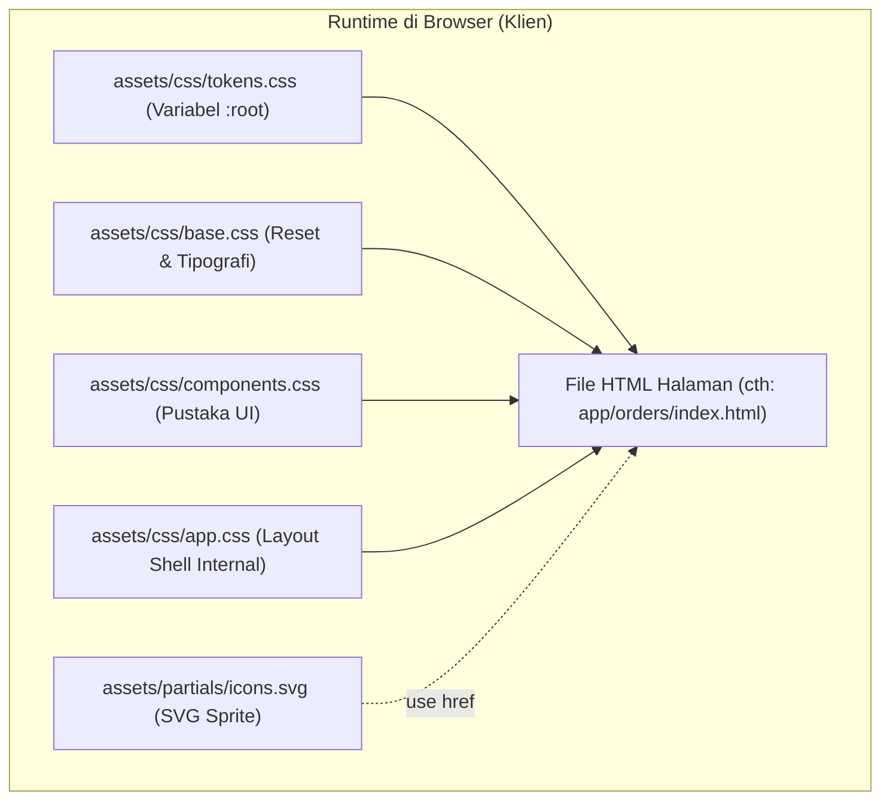
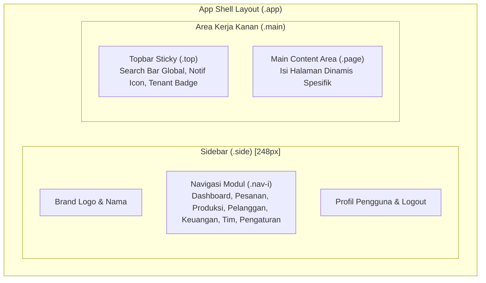

# 02. Analisis Codebase, Arsitektur Frontend & Desain Sistem

Dokumen ini membedah arsitektur teknis kode sumber (*codebase*) TailorHub, hierarki token CSS, pustaka komponen di `style-guide.html`, struktur App Shell, serta evaluasi kualitas kode yang telah diimplementasikan.

---

## 1. Filosofi & Pilihan Arsitektur Frontend

### 1.1 Zero-Build Multi-Page Architecture (MPA)
Alih-alih langsung menggunakan framework JavaScript kompleks dengan proses *build* yang berat (seperti Next.js, Vite, atau Nuxt) sejak hari pertama, repositori TailorHub dibangun dengan pendekatan **Vanilla HTML5, CSS3 murni, dan JavaScript modular tanpa kompilasi (*Zero-Build*)**.



### 1.2 Mengapa Pilihan Ini Sangat Tepat untuk Tim 6 Orang?
1. **Eliminasi Konflik Build & Dependensi**: Enam pengembang dapat bekerja secara simultan tanpa risiko *merge conflict* pada `package-lock.json`, perbedaan versi Node.js, atau kegagalan kompilasi Webpack/Vite.
2. **Onboarding Pengembang Instan**: Setiap anggota tim dapat langsung menjalankan proyek cukup dengan membuka file HTML di peramban web atau menggunakan ekstensi VS Code *Live Server*.
3. **Pemisahan Gaya yang Sangat Ketat**: Dengan memusatkan seluruh gaya ke file CSS bersama, tampilan antarmuka dijamin 100% konsisten antar halaman.
4. **Kesiapan Migrasi ke Framework Modern**: Struktur kode HTML yang semantik dan bersih mempermudah proses pemindahan (*porting*) ke komponen React/Vue/Blade di kemudian hari saat backend diintegrasikan.

---

## 2. Desain Sistem & Hierarki CSS Tokens

Repositori ini menerapkan disiplin desain sistem berbasis **CSS Custom Properties (`:root`)** yang didefinisikan dalam `assets/css/tokens.css` (bersumber dari `style-guide.html`).

### 2.1 Palet Warna Utama & Identitas Visual
Warna TailorHub mengangkat tema *Warm Artisanal* yang mencerminkan nuansa studio jahit profesional, hangat, dan terpercaya:

| Token CSS | Kode Warna Hex | Peruntukan & Nuansa Psikologis |
|---|---|---|
| `--clay` | `#C05424` | **Warna Utama (Terracotta/Clay)**: Melambangkan kerajinan, bahan alami, kehangatan benang dan kain. Digunakan untuk tombol utama, tab aktif, dan aksen brand. |
| `--clay-700` | `#9E4218` | Status hover tombol utama dan aksen gelap. |
| `--clay-100` | `#F9DFCF` | Latar belakang aksen lembut (*subtle tint*). |
| `--cream` | `#FFF8EF` | **Latar Belakang Dasar Aplikasi**: Memberikan kesan nyaman pada mata saat bekerja berjam-jam di layar monitor. |
| `--paper` | `#FFFDFA` | Latar belakang kartu (*card*), modal dialog, dan kontainer form. |
| `--ink` | `#3C2418` | **Teks Utama**: Warna cokelat gelap hangat, lebih bersahabat dan kontras dibanding hitam pekat `#000000`. |
| `--indigo` | `#495ECD` | **Warna Aksen Sekunder**: Memberikan kontras modern untuk fitur tracking dan elemen interaktif sekunder. |
| `--sand` | `#EADBC8` | Garis tepi (*border*), pemisah tabel, dan garis pembatas kartu. |

### 2.2 Peta Status Semantik SOLID (Wajib Diikuti)
Salah satu aturan ketat dalam proyek ini adalah: **Status chip wajib SOLID (latar pekat + teks putih)**, dilarang menggunakan latar belakang pudar/transparan demi keterbacaan tinggi di berbagai kondisi pencahayaan layar.

#### A. Status Produksi (7 Tahapan Pipeline):
```
[Antrean: #7A6155] ➔ [Pemotongan: #495ECD] ➔ [Penjahitan: #C05424] ➔ [Finishing: #9A6209] ➔ [QC: #3C4FA6] ➔ [Selesai: #2F8F5B] ➔ [Diambil: #20683F]
```
- `.chip--queue` (`--s-queue`: `#7A6155`) — Antrean pesanan (Taupe netral).
- `.chip--cut` (`--s-cut`: `#495ECD`) — Pemotongan kain (Indigo).
- `.chip--sew` (`--s-sew`: `#C05424`) — Penjahitan pakaian (Clay utama).
- `.chip--finish` (`--s-finish`: `#9A6209`) — Pemasangan kancing, obras, setrika uap (Amber tua).
- `.chip--qc` (`--s-qc`: `#3C4FA6`) — Pemeriksaan kualitas jahitan & ukuran (Indigo pekat).
- `.chip--done` (`--s-done`: `#2F8F5B`) — Selesai & siap diambil (Hijau daun).
- `.chip--taken` (`--s-taken`: `#20683F`) — Sudah diserahkan ke pelanggan (Hijau tua).

#### B. Status Pembayaran:
- `.chip--unpaid` (`--pay-unpaid`: `#C0392B`) — Belum Bayar (Merah tegas).
- `.chip--dp` (`--pay-dp`: `#9A6209`) — Uang Muka / DP Terbayar (Amber/Cokelat keemasan).
- `.chip--paid` (`--pay-paid`: `#2F8F5B`) — Lunas (Hijau sukses).

#### C. Status Urgensi Deadline:
- `.chip--clay` (`--warn`: `#B06E12`) — Mendekati deadline ($\le$ 2 hari).
- `.chip--danger` (`--red`: `#C0392B`) — Melewati batas deadline.

---

## 3. Pustaka Komponen UI (`components.css`)

Semua komponen antarmuka telah distandarisasi di dalam `assets/css/components.css`:
1. **Tombol (`.btn`)**:
   - `.btn--primary`: Tombol aksi utama (latar belakang `--clay` dengan transisi hover mengangkat bayangan).
   - `.btn--secondary` & `.btn--outline`: Tombol pendukung dan pembatalan.
   - `.btn--sm` & `.btn--lg`: Variasi ukuran kontrol form.
2. **Formulir & Kontrol Masukan**:
   - `.field`: Kontainer pembungkus label, input, dan pesan petunjuk/validasi.
   - `.input-group`: Wadah fleksibel yang menyatukan ikon SVG di sisi kiri dengan kolom input teks.
   - `.input:focus`: Memberikan *ring glow* oranye lembut (`box-shadow: 0 0 0 4px rgba(192,84,36,.12)`).
3. **Tabel Data Responsif (`.table-wrap` & `.table`)**:
   - Header tabel tegas dengan teks huruf kecil berjarak renggang (*letter-spacing*).
   - Baris tabel dilengkapi efek hover lembut dan integrasi status chip di kolom tengah.
4. **Kartu Metrik / KPI (`.kpi-card`)**:
   - Kotak statistik angka besar, label ringkas, dan indikator persentase pertumbuhan operasional.
5. **Modal Dialog (`.modal-backdrop` & `.modal`)**:
   - Lapisan latar belakang transparan gelap dengan animasi pembuka halus untuk konfirmasi hapus data atau penambahan cepat.

---

## 4. Arsitektur App Shell (`app.css` & `app/dashboard.html`)

Halaman internal aplikasi (`app/*` dan `account/*`) menggunakan kerangka terpadu yang disebut **App Shell**:



### Mekanisme Responsif Mobile:
- Pada layar desktop ($\ge 1024\text{px}$), sidebar terkunci di sisi kiri (*position: sticky*).
- Pada layar mobile ($< 1024\text{px}$), sidebar bergeser keluar layar (*off-canvas*) menggunakan transformasi `-translateX(100%)`.
- Ketika tombol hamburger (`.burger`) ditekan, kelas `.nav-open` ditambahkan ke kontainer induk, memunculkan sidebar dan tirai gelap (`.scrim`) untuk kenyamanan penggunaan satu tangan di smartphone.

---

## 5. Audit Kualitas Implementasi Berjalan

### 5.1 Modul Publik (`index.html`)
- **Status**: Sangat Matang (*Production Ready*).
- **Kelebihan**: Tipografi `Plus Jakarta Sans` diterapkan secara elegan, visualisasi fitur sebelum vs sesudah disajikan menarik, responsif di segala ukuran layar, serta memiliki micro-interactions yang mulus.

### 5.2 Modul Autentikasi & Akun Pengguna (`auth/` & `account/` oleh Dev 2 - Angel)
- **Status**: Lengkap & Merge Selesai.
- **Kelebihan**:
  - Halaman `auth/onboarding.html` memiliki wizard interaktif dengan indikator langkah yang rapi.
  - Form dilengkapi fitur interaktif (misal: toggle lihat password dengan ikon mata).
  - Tautan navigasi internal sudah terarah ke halaman tujuan yang benar.

### 5.3 Modul Pesanan & Pelanggan (`app/orders/` & `app/customers/` oleh Dev 4 - Putri/Zelvia)
- **Status**: Kode Lengkap (berada di riwayat commit PR #2).
- **Kelebihan**:
  - `print.html`: Didesain khusus menggunakan CSS `@media print` sehingga saat ditekan Ctrl+P, elemen navigasi otomatis tersembunyi dan hanya mencetak nota bersih ber-QR Code.
  - `detail.html`: Memiliki 4 tab interaktif (*Detail Pesanan*, *Tahap Produksi*, *Riwayat Pembayaran*, dan *Log Aktivitas*).
  - Struktur form pesanan mencakup input ukuran garmen yang detail (lingkar dada, panjang celana, dll).

---

## 6. Identifikasi Technical Debt & Rekomendasi Solusi

| Isu / Technical Debt | Dampak pada Sistem | Rekomendasi Perbaikan Tim |
|---|---|---|
| **Duplikasi SVG Sprite di Setiap File** | Setiap file HTML menyisipkan `<svg>` dengan puluhan `<symbol>` di baris awal dokumen, menambah ukuran payload HTML hingga 10–15 KB per halaman. | Gunakan berkas `assets/partials/icons.svg` tunggal dengan sintaks `<use href="/assets/partials/icons.svg#i-check"/>` atau sertakan partial secara otomatis jika telah beralih ke engine templating. |
| **Path Relatif Aset (`../` vs `../../`)** | File di level sub-folder (seperti `app/orders/create.html`) membutuhkan `../../assets/` sedangkan di level `auth/` membutuhkan `../assets/`. Risiko salah path saat memindahkan file. | Sepakati penggunaan root path absolut `/assets/...` jika menjalankan web server lokal (seperti Live Server atau `npx serve`), atau pertahankan relative path secara teliti sesuai hierarki folder. |
| **Simulasi Interaktivitas Statis (Mock State)** | Filter tabel, tab switching, dan tombol update status belum memiliki penyimpanan data lokal. | Gunakan JavaScript ringan dengan `localStorage` (di `assets/js/main.js`) untuk menyimpan status contoh pesanan dan memperagakan demo interaktif yang meyakinkan saat presentasi kuliah. |
| **Konsistensi Nama Variabel Class** | Sebagian halaman awal masih mencampur nama selektor custom di luar `components.css`. | Jalankan audit berkala untuk memastikan semua warna menggunakan `var(--...)` dan komponen memakai kelas resmi dari `style-guide.html`. |
