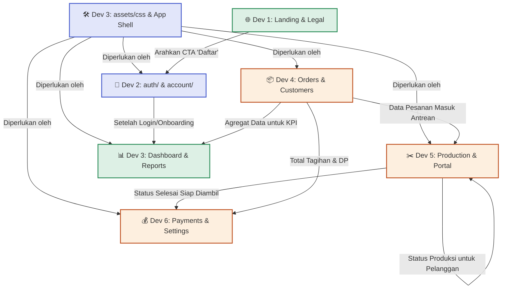

# 03. Analisis Pembagian Kerja Tim & Dinamika Kolaborasi

Dokumen ini menganalisis pembagian tugas proyek TailorHub untuk **6 developer**, struktur pembagian 67 halaman, analisis jalur kritis (*Critical Path*), potensi hambatan kolaborasi (*bottlenecks*), serta evaluasi alur kerja Git.

---

## 1. Matriks Distribusi Kerja 6 Developer

Beban kerja pembuatan antarmuka TailorHub didistribusikan ke 6 pengembang dengan rata-rata 10–13 halaman per orang, terbagi berdasarkan domain fungsional:

| Bagian | Pengembang | Peran & Area Fokus | Jumlah Halaman | Tingkat Kompleksitas UI | Status Saat Ini |
|:---:|---|---|:---:|:---:|:---:|
| **1** | **Dev 1 (Danil)** | **Situs Publik, Marketing & Sistem** `index.html`, `pricing.html`, `features.html`, `about.html`, `contact.html`, `help-center.html`, `terms.html`, `privacy.html`, `404.html`, `maintenance.html` | 10 Halaman | Sedang *(Banyak layout statis, copywriting produk, dan estetika visual publik)* | `index.html` selesai; halaman pendukung dalam proses. |
| **2** | **Dev 2 (Angel)** | **Autentikasi & Akun Pengguna** `auth/register.html`, `auth/login.html`, `auth/verify-email.html`, `auth/forgot-password.html`, `auth/reset-password.html`, `auth/accept-invitation.html`, `auth/onboarding.html`, `account/profile.html`, `account/change-password.html`, `account/preferences.html` | 10 Halaman | Tinggi *(Formulir sensitif, wizard multi-langkah onboarding, validasi inline)* | **Selesai 100%** (Telah dimerge ke cabang `main` melalui PR #1). |
| **3** | **Dev 3** | **Fondasi Aset, Dashboard & Laporan** `assets/css/*`, `assets/partials/*`, `app/dashboard.html`, `app/search.html`, `app/reports/index.html`, `app/reports/orders.html`, `app/reports/income.html`, `app/reports/customers.html`, `app/reports/productivity.html`, `app/reports/export.html`, `app/notifications/index.html`, `app/notifications/settings.html` | 10 Halaman + Core Assets | Sangat Tinggi *(Fondasi App Shell, grafik analitik bisnis, pusat notifikasi in-app)* | Fondasi CSS dan `dashboard.html` selesai; laporan & notif pending. |
| **4** | **Dev 4 (Putri / Zelvia)** | **Manajemen Pesanan & Direktori Customer** `app/orders/index.html`, `create.html`, `edit.html`, `detail.html`, `search.html`, `print.html`, `delete-modal.html`, `bulk-update.html`, `app/customers/index.html`, `detail.html`, `form.html` | 11 Halaman | Sangat Tinggi *(Form fitting badan, nota print preview, tab detail multifungsi)* | **Selesai di PR #2** (Tersimpan di branch history, dalam proses penyelarasan merge). |
| **5** | **Dev 5 (Alan / Anda)** | **Produksi, Tugas Staf & Portal Customer** `app/production/board.html`, `list.html`, `detail.html`, `update-status.html`, `deadline-alerts.html`, `app/staff/my-tasks.html`, `task-detail.html`, `portal/landing.html`, `track.html`, `track-result.html`, `customer-login.html`, `customer-register.html`, `customer-account.html` | 13 Halaman | Sangat Tinggi *(Kanban drag-and-drop, UI mobile staf jahit, portal publik tanpa login)* | **Fokus Aktif Anda** (Cabang kerja aktif: `alan`). |
| **6** | **Dev 6** | **Keuangan, Tim & Pengaturan Tenant** `app/payments/index.html`, `record.html`, `invoice.html`, `receipt.html`, `detail.html`, `app/team/index.html`, `member-detail.html`, `activity-log.html`, `app/settings/tenant.html`, `billing.html`, `notifications.html`, `order-preferences.html`, `security.html` | 13 Halaman | Tinggi *(Kuitansi bayar, invoice cetak, manajemen hak akses RBAC, konfigurasi sistem)* | Menunggu pengerjaan. |

---

## 2. Analisis Ketergantungan Antar Modul (Critical Path Analysis)

Aliran data dan ketergantungan desain antarmuka TailorHub membentuk jalur kritis sebagai berikut:

### Penjelasan Jalur Kritis:
1. **Dev 3 sebagai Fondasi Awal**: Pembagian kerja menginstruksikan Dev 3 mengekstrak CSS dan App Shell dari `app/dashboard.html` ke `assets/css/*.css`. Hal ini telah terealisasi dengan baik, sehingga pengembang lain dapat bekerja seragam.
2. **Kopling Tertinggi: Dev 4 $\longleftrightarrow$ Dev 5**:
   - Dev 4 membuat pesanan baru (`app/orders/create.html`).
   - Begitu pesanan disimpan, pesanan tersebut harus muncul di kolom **Antrean** pada Papan Kanban milik Dev 5 (`app/production/board.html`).
   - Kode unik pesanan (misal `TLR-2026-001`) yang dicetak oleh Dev 4 (`app/orders/print.html`) menjadi kunci pencarian di Portal Tracking milik Dev 5 (`portal/track.html`).
3. **Kopling Dev 5 $\longleftrightarrow$ Dev 6 (Handover Fisik & Pelunasan)**:
   - Ketika pakaian telah selesai (`.chip--done`) dan pelanggan datang mengambil pakaian (`.chip--taken`), kasir memeriksa status pembayaran di modul Dev 6 (`app/payments/`). Jika status masih `DP`, staf mencatat pelunasan sebelum menyerahkan barang.

---

## 3. Identifikasi Titik Rawan Integrasi (Bottlenecks & Collision Risks)

### 3.1 Inkonsistensi Jalur Navigasi Antar Halaman (`Dead Links`)
- **Risiko**: Karena halaman dikerjakan secara terpisah, tombol aksi rawan diisi tautan kosong (`href="#"`) atau salah memanggil path relatif.
- **Contoh Kasus**: Tombol "Lihat Progres Produksi" pada detail pesanan Dev 4 (`app/orders/detail.html`) harus mengarah dengan tepat ke `../production/detail.html?id=...` milik Dev 5.
- **Mitigasi**: Seluruh pengembang wajib mengacu pada tabel penamaan file di `structure-folder.md` dan memverifikasi tautan lintas folder sebelum mengajukan Pull Request.

### 3.2 Modul Portal Customer: Bebas dari App Shell
- **Risiko**: Dev 5 tidak boleh menyalin sidebar dan topbar internal (`app.css`) ke dalam folder `portal/`. Portal pelanggan adalah area publik eksternal yang diakses oleh pelanggan biasa, bukan staf usaha.
- **Mitigasi**: Pastikan seluruh halaman di `portal/*.html` hanya mengimpor `tokens.css`, `base.css`, dan `components.css`. Header portal hanya memuat logo tenant, kontak bantuan, dan tombol keluar/kembali.

### 3.3 Variasi Format Data Mock
- **Risiko**: Format kode pesanan di Dev 4 ditulis `ORD-001`, sementara di Dev 5 ditulis `TLR-2026-0891`. Perbedaan ini menimbulkan kesan inkonsisten pada presentasi tim.
- **Mitigasi**: Sepakati format data contoh seragam:
  - Kode Pesanan: `TLR-2026-0891`, `TLR-2026-0892`
  - Nama Tenant Contoh: `Berkah Taylor & Konveksi`
  - Nama Pelanggan: `Ibu Ratna Dewi`, `Bpk. Hendra Gunawan`

---

## 4. Evaluasi Alur Kerja Git & Tata Kelola Cabang

### 4.1 Standar Alur Git Tim
Sesuai `README.md`, tim menerapkan aturan berikut:
1. **Dilarang Commit Langsung ke `main`**: Semua pekerjaan dilakukan di branch per modul/fitur (`dev<nomor>/<area>-<halaman>`).
2. **Review Sebelum Merge**: Pull Request wajib direview oleh pengembang lain guna memverifikasi checklist kualitas.
3. **Imutabilitas Desain Inti**: File `assets/css/tokens.css` dan `assets/partials/icons.svg` tidak boleh diubah sepihak tanpa musyawarah tim.

### 4.2 Analisis Riwayat Commit Terkini
Berdasarkan log repositori:
- **PR #1 (Dev 2 - Angel)**: Berhasil di-merge dengan mulus ke `main` (commit `f64411e`). Seluruh halaman autentikasi dan pengaturan akun telah tertata rapi.
- **PR #2 (Dev 4 - Putri/Zelvia)**: Modul pesanan dan pelanggan telah dibuat dengan kualitas sangat baik (11 file). Sempat terjadi revert di branch `main` (`33d27e1`) untuk penataan commit, namun seluruh file kode tetap aman di riwayat git.
- **Cabang Aktif (`alan`)**: Berada pada cabang Dev 5 untuk menggarap 13 halaman modul Produksi, Staf, dan Portal Customer.

### 4.3 Checklist "Definition of Done" (DoD) Sebelum Pull Request
Setiap halaman dinyatakan selesai apabila memenuhi 8 kriteria:
- [x] Menggunakan variabel CSS token (`var(--...)`), tidak ada hardcode kode hex/pixel.
- [x] Komponen tombol, input, tabel, dan card mengacu pada `style-guide.html`.
- [x] Chip status menggunakan kelas semantik solid (`.chip--queue`, `.chip--cut`, dll).
- [x] Halaman `app/` menyertakan App Shell lengkap (sidebar + topbar) dengan menu aktif ditandai `.is-on`.
- [x] Halaman `portal/` bersih dari sidebar internal (desain mandiri mobile-first).
- [x] Tampilan rapi dan tidak mengalami scroll horizontal pada layar smartphone ($\pm 390\text{px}$).
- [x] Lokasi dan nama file sesuai persis dengan `structure-folder.md`.
- [x] Tidak ada pranala mati (`href="#"`) untuk fitur yang halamannya telah selesai dibuat.
