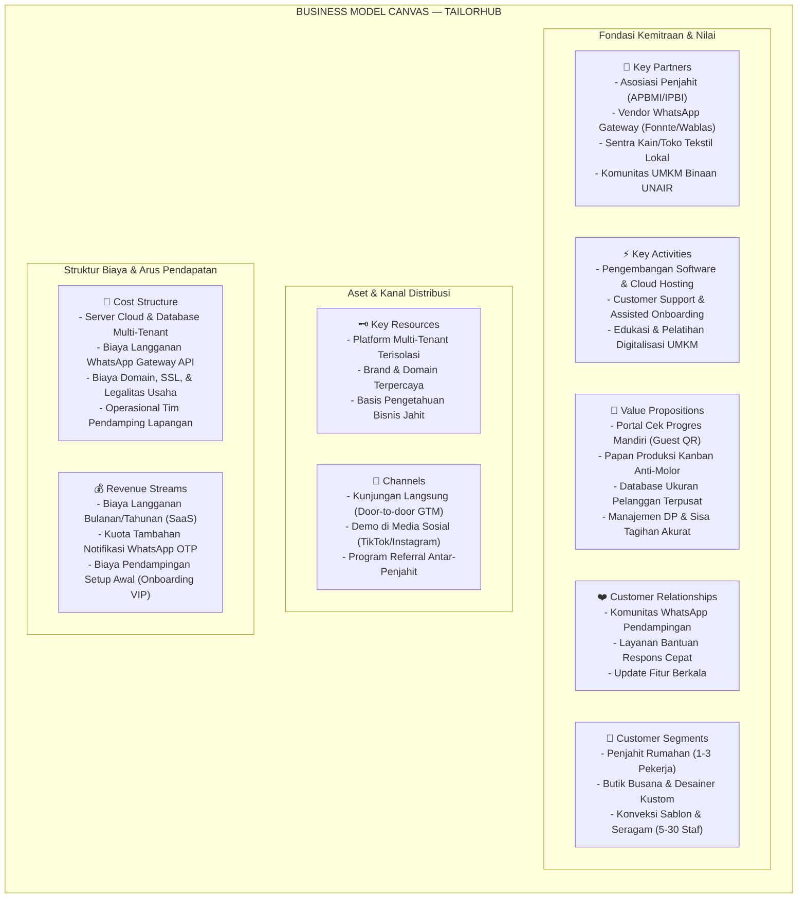
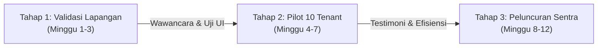

# 04. Analisis Bisnis & Kewirausahaan (Perspektif KWU UNAIR)

Dokumen ini menyajikan analisis strategis TailorHub dari sudut pandang akademik **Mata Kuliah Kewirausahaan (KWU) — Universitas Airlangga**. Analisis ini mencakup *Business Model Canvas* (BMC), diferensiasi pasar, strategi monetisasi, analisis SWOT, serta rencana *Go-To-Market* (GTM) terapan di wilayah Surabaya dan sekitarnya.

---

## 1. Konteks Akademik & Urgensi Digitalisasi UMKM

Sektor usaha jahit dan konveksi di Indonesia merupakan pilar ekonomi kerakyatan dengan penyerapan tenaga kerja informal yang masif. Di wilayah metropolitan seperti Surabaya dan sekitarnya (Gerbangkertosusila), industri ini terbagi menjadi sentra garmen/konveksi seragam skala menengah dan ribuan penjahit rumahan skala mikro.

Meskipun memiliki perputaran omzet yang tinggi—terutama pada musim pendaftaran sekolah, wisuda kampus, dan menjelang hari raya Idulfitri—mayoritas pelaku usaha masih terbelenggu oleh **metode tata kelola manual abad ke-20**:
- Ketergantungan pada nota kertas karbon yang rentan hilang atau rusak.
- Ketiadaan pencatatan riwayat ukuran pelanggan yang terstruktur.
- Komunikasi status pengerjaan yang tidak transparan dan memakan pulsa/waktu.
- Tingginya risiko piutang macet akibat ketiadaan catatan uang muka (DP) yang terintegrasi.

TailorHub hadir bukan sekadar proyek pemrograman statis, melainkan sebuah **rancangan rintisan usaha teknologi (*Tech Startup*) berbasis SaaS yang bernilai komersial tinggi** untuk menjawab inefisiensi tersebut.

---

## 2. Business Model Canvas (BMC) TailorHub

---

## 3. Segmentasi Pelanggan & Analisis Kebutuhan

| Segmen Pengguna | Karakteristik Operasional | Titik Masalah Terbesar (Pain Points) | Solusi TailorHub yang Menjawab |
|---|---|---|---|
| **Penjahit Rumahan & Vermak** *(Mikro: 1–3 orang)* | Menerima vermak, jahit kebaya perorangan, baju harian. Menggunakan buku tulis biasa. | Ukuran pelanggan sering hilang; lupa deadline; pembukuan tercampur uang dapur. | Form pesanan ringkas, database ukuran pelanggan tersimpan permanen, paket harga sangat terjangkau/gratis. |
| **Butik Busana Kustom & Modiste** *(Kecil: 3–7 orang)* | Jahitan gaun pesta, jas formal, kebaya pengantin bernilai tinggi (Rp 1jt–10jt per stel). | Pelanggan menuntut kesempurnaan dan sering menanyakan detail progres jahit. | Portal tracking elegan ber-branding butik, lampiran foto referensi model kain, timeline fitting transparan. |
| **Konveksi Kaos & Seragam** *(Menengah: 8–30+ orang)* | Memproduksi ribuan potong seragam kantor, kaos komunitas, jaket almamater kampus. | Mengelola banyak penjahit borongan; rawan salah potong pola; keterlambatan QC. | Papan Kanban produksi multi-tahap, filter beban kerja per staf penjahit, alert pesanan kritis. |

---

## 4. Analisis SWOT TailorHub

### Kekuatan (Strengths)
1. **Fokus Sangat Spesifik (Hyper-Niche)**: Didesain murni untuk alur kerja jahit (ada field ukuran badan, tahap potong-jahit-QC-fitting), tidak generik seperti aplikasi kasir ritel (POS minimarket) atau ERP manufaktur yang rumit.
2. **Tanpa Hambatan bagi Pelanggan Akhir**: Pelanggan tidak dipaksa mengunduh aplikasi mobile di Play Store; cukup scan QR Code di nota fisik.
3. **Desain Visual Kelas Atas**: Standar estetika *warm terracotta* menciptakan citra profesional dan dapat meningkatkan prestise tempat jahit di mata pelanggannya.

### Kelemahan (Weaknesses)
1. **Ketergantungan Infrastruktur WhatsApp**: Integrasi notifikasi sangat bergantung pada stabilitas API pihak ketiga (Fonnte/Wablas).
2. **Tahap Prototipe Statis**: Saat ini sistem masih berupa antarmuka statis dan memerlukan implementasi backend database untuk deployment komersial nyata.

### Peluang (Opportunities)
1. **Pasar Surabaya yang Sangat Potensial**: Sentra konveksi di Rungkut, Bratang, Pasar Atom, dan Pusat Grosir Surabaya (PGS) menampung ribuan pengusaha yang belum tersentuh software spesialis.
2. **Kebutuhan Musiman yang Pasti**: Momen wisuda perguruan tinggi (UNAIR, ITS, UNESA) serta tahun ajaran baru sekolah selalu menciptakan lonjakan pesanan yang membutuhkan manajemen antrean ketat.
3. **Ekspansi Ekosistem**: Peluang kerja sama dengan toko bahan kain dan grosir kancing untuk penyediaan bahan baku langsung dari aplikasi.

### Ancaman (Threats)
1. **Keengganan Mengubah Kebiasaan (Habit Inertia)**: Penjahit senior generasi tua yang enggan beralih dari buku nota manual.
2. **Aplikasi Pencatatan Kas Gratisan**: Kehadiran aplikasi pencatatan keuangan gratis (seperti BukuKas/BukuWarung) yang meski tidak memiliki fitur kanban jahit, sudah lebih dulu dikenal masyarakat.

---

## 5. Model Monetisasi & Strategi Penetapan Harga (Pricing)

Mengacu pada PRD §10 mengenai model berlangganan, rekomendasi struktur penetapan harga yang kompetitif untuk pasar Indonesia:

| Paket Langganan | Target Usaha | Biaya / Bulan | Batasan & Fasilitas |
|---|---|:---:|---|
| **Pemula (Starter)** | Penjahit Rumahan Pemula | **Rp 0** *(Gratis Selamanya)* | Maksimal 25 pesanan aktif/bulan, 1 pengguna (Owner), portal tracking standar, pencatatan ukuran dasar. |
| **Butik Pro** | Butik Jahit & Modiste Mandiri | **Rp 79.000** / bulan | Kuota pesanan hingga 150/bulan, 3 akun staf, branding logo sendiri di portal tracking, 100 kuota notifikasi WhatsApp otomatis, ekspor laporan PDF. |
| **Konveksi Scale** | Pabrik Konveksi & Vendor Seragam | **Rp 199.000** / bulan | **Pesanan tanpa batas (*Unlimited*)**, pengguna staf tanpa batas, multi-tahap produksi kustom, prioritas pengiriman WhatsApp, export CSV/Excel, audit log aktivitas. |

### Potensi Pendapatan Tambahan (Add-on Streams):
- **Paket Kuota WhatsApp**: Rp25.000 per 250 pesan notifikasi status otomatis.
- **Paket Onboarding VIP & Starter Kit**: Rp250.000 (Pendampingan input data awal langsung ke lokasi + 100 lembar stiker QR Code fisik eksklusif untuk nota).

---

## 6. Rencana Go-To-Market (GTM) Terapan di Wilayah Surabaya

Untuk validasi mata kuliah Kewirausahaan, tim dapat mengeksekusi strategi peluncuran dalam 3 tahap praktis:

1. **Tahap 1: Validasi Prototipe Langsung ke Penjahit Kampus**:
   - Membawa laptop/tablet ke 5 penjahit vermak dan modiste di sekitar kampus UNAIR (Kampus B Dharmawangsa & Kampus C Mulyorejo).
   - Menunjukkan demo antarmuka dan meminta mereka mencoba alur input pesanan serta simulasi cek status via QR.
2. **Tahap 2: Program Pilot Gratis untuk 10 Mitra UMKM**:
   - Memilih 10 tempat jahit terpilih untuk menggunakan sistem selama 1 bulan penuh secara gratis.
   - Mengukur metrik kunci: penurunan jumlah chat komplain pelanggan dan keakuratan jadwal selesai pakaian.
3. **Tahap 3: Penetrasi Sentra Garmen Surabaya**:
   - Sosialisasi melalui brosur dan demo singkat di sentra penjualan kain jalanan Pasar Atom dan Pusat Grosir Surabaya (PGS).
   - Memberikan promo diskon 50% bagi penjahit yang mendaftar melalui rekomendasi mitra percontohan (*Referral Program*).
