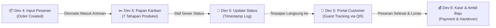

# 05. Panduan Eksekusi & Cetak Biru Teknis: Dev 5 (Alan)

Dokumen ini adalah panduan kerja taktis khusus untuk **Developer 5 (Alan)** pada cabang kerja `alan`. Dev 5 bertanggung jawab atas **13 halaman penting** yang menghubungkan dua dunia: **Lantai Operasional Produksi Internal (`app/production/` & `app/staff/`)** dan **Wajah Publik Pelanggan (`portal/`)**.

---

## 1. Posisi Strategis Dev 5 dalam Siklus Sistem

Sebagai pemilik modul Produksi dan Portal, pekerjaan Dev 5 memegang peranan paling vital dalam membuktikan *Core Value Proposition* TailorHub:



---

## 2. Rincian 13 Halaman yang Wajib Dikerjakan

Modul Dev 5 terbagi menjadi **3 Sub-Modul**:

### 2.1 Sub-Modul A: Manajemen Produksi Internal (`app/production/`) — Menggunakan App Shell 🔒
*Wajib mengimpor:* `tokens.css` $\rightarrow$ `base.css` $\rightarrow$ `components.css` $\rightarrow$ `app.css`. Memakai struktur Sidebar + Topbar.

1. **`app/production/board.html` (Papan Kanban 7 Kolom) [M]**:
   - Menampilkan 7 kolom tahapan: `Antrean` $\rightarrow$ `Pemotongan` $\rightarrow$ `Penjahitan` $\rightarrow$ `Finishing` $\rightarrow$ `QC` $\rightarrow$ `Selesai` $\rightarrow$ `Diambil`.
   - Tiap kolom memiliki *header counter badge* (misal: "Penjahitan (4)").
   - Kartu pesanan memuat: Kode order (`TLR-2026-001`), nama customer, jenis item (misal "Kebaya Wisuda"), foto thumbnail model, nama penjahit (assignee), dan tanggal deadline.
   - Penanda visual badge: `.chip--clay` untuk $\le 2$ hari, `.chip--danger` jika lewat deadline.
   - Tombol toggle untuk berpindah ke tampilan tabel (*List View*).
2. **`app/production/list.html` (List View Pesanan Berjalan) [M]**:
   - Alternatif tampilan Kanban berbentuk tabel responsif.
   - Kolom: Kode Pesanan, Pelanggan, Produk, Tahap Saat Ini, Penanggung Jawab, Deadline, Aksi Cepat.
3. **`app/production/detail.html` (Detail Alur Produksi Pesanan) [M]**:
   - Timeline vertikal status produksi dengan pencatatan waktu otomatis (*timestamp*).
   - Info spesifikasi teknis kain, benang, dan instruksi khusus dari desainer.
   - Riwayat catatan revisi/fitting.
4. **`app/production/update-status.html` (Modal / Formulir Update Tahap) [M]**:
   - Dropdown pemilihan tahap baru.
   - Input catatan pengerjaan (misal: *"Kain furing sudah dipasang, lanjut obras"*).
   - Tombol konfirmasi pemicu simulasi kirim WhatsApp ke customer.
5. **`app/production/deadline-alerts.html` (Pusat Pantauan Deadline) [S]**:
   - Tampilan khusus untuk manajer produksi memantau pesanan yang terancam terlambat, diurutkan dari yang paling mendesak.

---

### 2.2 Sub-Modul B: Antarmuka Kerja Staf Penjahit (`app/staff/`) — Menggunakan App Shell 🔒
*Dirancang khusus untuk kenyamanan layar smartphone ($\pm 390\text{px}$) tukang jahit di meja mesin:*

6. **`app/staff/my-tasks.html` (Daftar Tugas Saya) [M]**:
   - Hanya menampilkan kartu pesanan yang ditugaskan ke staf yang sedang login.
   - Pengelompokan: *Perlu Dikerjakan Hari Ini*, *Sedang Berjalan*, dan *Selesai*.
   - Tombol aksi cepat berukuran besar: "Mulai Kerjakan" dan "Tandai Selesai Tahap Ini".
7. **`app/staff/task-detail.html` (Instruksi Rinci Tugas) [M]**:
   - Menampilkan foto acuan model jahitan secara jelas, instruksi penjahitan, dan ukuran potongan pola.

---

### 2.3 Sub-Modul C: Portal Customer Publik (`portal/`) — TANPA APP SHELL 🌐
> ⚠️ **PERINGATAN KERAS ARSITEKTUR:** Seluruh halaman di folder `portal/` **DILARANG mengimpor `app.css`** dan **DILARANG menyertakan sidebar internal**. Halaman ini diakses oleh pelanggan publik melalui smartphone mereka.

8. **`portal/landing.html` (Beranda Portal Tenant) [M]**:
   - Header publik: Logo tempat jahit, nama usaha (*misal "Berkah Taylor & Konveksi"*), slogan, dan jam buka.
   - Area hero ramah pengguna: Ajakan melacak status pesanan secara mandiri.
   - Tombol pintas: "Lacak Pesanan Sekarang" dan tautan WhatsApp CS.
9. **`portal/track.html` (Formulir Lacak Pesanan Guest) [M]**:
   - Kolom input besar: Masukkan Kode Pesanan (contoh placeholder: `TLR-2026-0891`).
   - Ilustrasi pendukung: *"Kode dapat dilihat pada nota cetak atau pesan WhatsApp Anda"*.
   - Tombol pencarian "Cek Status Jahitan".
10. **`portal/track-result.html` (Hasil Lacak Pesanan) [M]**:
    - **Halaman paling krusial bagi kepuasan pelanggan!**
    - Rangkuman header: Nama pelanggan, jenis pakaian, dan badge status pembayaran (`DP` / `Lunas`).
    - **Visual Stepper Timeline Progres**: Menampilkan 7 tahapan dengan garis penghubung. Tahap yang sudah selesai diberi ikon centang hijau, tahap yang sedang dikerjakan berdenyut/oranye (`--clay`), dan tahap berikutnya berwarna abu-abu netral.
    - Estimasi tanggal perkiraan selesai / janji fitting.
    - Tombol bantuan: *"Ada pertanyaan tentang pesanan ini? Hubungi WhatsApp Penjahit"*.
11. **`portal/customer-login.html` (Masuk Akun Pelanggan) [C]**:
    - Formulir login khusus pelanggan untuk melihat arsip pesanan lama.
12. **`portal/customer-register.html` (Daftar Akun Pelanggan) [C]**:
    - Pendaftaran akun pelanggan baru secara opsional.
13. **`portal/customer-account.html` (Dashboard Akun Pelanggan) [C]**:
    - Riwayat seluruh pesanan yang pernah dijahit di tenant tersebut.

---

## 3. Template Boilerplate untuk Dev 5

### 3.1 Kerangka Halaman Internal (`app/production/board.html`)
```html
<!DOCTYPE html>
<html lang="id">
<head>
  <meta charset="UTF-8">
  <meta name="viewport" content="width=device-width, initial-scale=1.0">
  <title>Papan Produksi — TailorHub</title>
  <link rel="preconnect" href="https://fonts.googleapis.com">
  <link href="https://fonts.googleapis.com/css2?family=Plus+Jakarta+Sans:wght@400;500;600;700;800&display=swap" rel="stylesheet">
  <!-- Impor 4 CSS wajib untuk area internal -->
  <link rel="stylesheet" href="../../assets/css/tokens.css">
  <link rel="stylesheet" href="../../assets/css/base.css">
  <link rel="stylesheet" href="../../assets/css/components.css">
  <link rel="stylesheet" href="../../assets/css/app.css">
</head>
<body>
  <div class="app">
    <div class="scrim" onclick="document.querySelector('.app').classList.remove('nav-open')"></div>
    
    <!-- SIDEBAR (Salin dari app/dashboard.html, tandai navigasi produksi dengan .is-on) -->
    <aside class="side">
      <!-- ... -->
      <a class="nav-i is-on" href="board.html">
        <svg width="20" height="20"><use href="../../assets/partials/icons.svg#i-scissors"/></svg>
        <span>Produksi</span>
      </a>
      <!-- ... -->
    </aside>

    <div class="main">
      <!-- TOPBAR (Salin dari dashboard.html) -->
      <header class="top">
        <!-- ... -->
      </header>

      <!-- KONTEN KANBAN -->
      <main class="page">
        <!-- Struktur Kanban 7 Kolom -->
      </main>
    </div>
  </div>
</body>
</html>
```

### 3.2 Kerangka Halaman Publik Customer (`portal/track-result.html`)
```html
<!DOCTYPE html>
<html lang="id">
<head>
  <meta charset="UTF-8">
  <meta name="viewport" content="width=device-width, initial-scale=1.0">
  <title>Progres Pesanan TLR-2026-0891 — Berkah Tailor</title>
  <link rel="preconnect" href="https://fonts.googleapis.com">
  <link href="https://fonts.googleapis.com/css2?family=Plus+Jakarta+Sans:wght@400;500;600;700;800&display=swap" rel="stylesheet">
  <!-- HANYA 3 CSS (DILARANG mengimpor app.css di portal) -->
  <link rel="stylesheet" href="../assets/css/tokens.css">
  <link rel="stylesheet" href="../assets/css/base.css">
  <link rel="stylesheet" href="../assets/css/components.css">
</head>
<body style="background:var(--cream); min-height:100vh; padding: 24px 16px;">
  <div style="max-width: 640px; margin: 0 auto;">
    <!-- Header Publik Sederhana -->
    <header style="text-align: center; margin-bottom: 28px;">
      <h2 style="color:var(--ink);">Berkah Tailor &amp; Konveksi</h2>
      <p style="font-size:0.9rem; color:var(--ink-70);">Status Pengerjaan Busana Anda</p>
    </header>

    <!-- Kartu Hasil Pelacakan -->
    <div class="card" style="padding: 24px;">
      <!-- Rincian Pesanan & Timeline Stepper -->
    </div>
  </div>
</body>
</html>
```

---

## 4. Checklist Mandiri Dev 5 (Alan) Sebelum Merge

Sebelum mengajukan Pull Request ke `main`, lakukan verifikasi:
- [ ] Folder `app/production/` memiliki 5 file lengkap dan tombol toggle antara Kanban dan List berfungsi mulus.
- [ ] Folder `app/staff/` memiliki 2 file dengan tata letak ramah mobile di lebar 390px.
- [ ] Folder `portal/` memiliki 6 file dan sama sekali tidak memuat elemen sidebar internal.
- [ ] Seluruh chip status menggunakan nama kelas semantik solid (`chip--queue`, `chip--cut`, `chip--sew`, dll).
- [ ] Tautan navigasi dari Kanban (`board.html`) saat kartu diklik berhasil membuka `detail.html?id=...`.
- [ ] Seluruh file divalidasi tidak memiliki *horizontal scrollbar* tak terduga pada mode mobile inspektur peramban.
